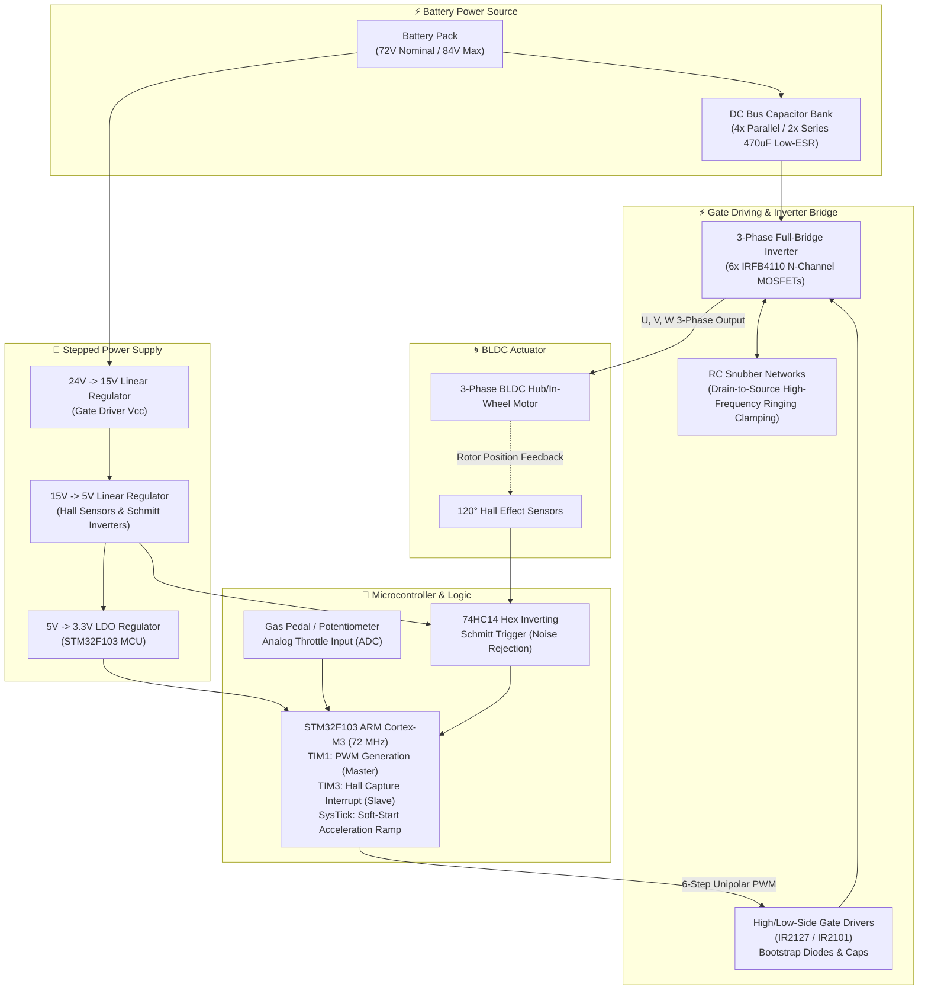

# Design and Implementation of a High-Power 3-Phase BLDC Motor Driver ⚡🚗
### Bachelor of Science (B.Sc.) Capstone Graduation Thesis Report & Defense Presentation
**Institution:** [Eskişehir Osmangazi University (ESOGÜ)](https://www.ogu.edu.tr) — Department of Electrical & Electronics Engineering  
**Academic Term:** June 2024 (Graduated April 2025)  
**Accreditation:** ABET (Accreditation Board for Engineering and Technology)  

**Project Team:**
* **Mustafa Yağcı** — Student ID: `151220192027`
* **Eren Köse** — Student ID: `151220202175`
* **Ersin Sarı** — Student ID: `151220194001`
* **Erdi Şentürk** — Student ID: `151220192101`

**Supervisory Committee:**
* **Assist. Prof. Dr. Gökhan Dındış** *(Project Advisor — Mechatronic Systems, Control & Sensor Integration)*
* **Assoc. Prof. Dr. Atabak Najafi** *(Committee Member)*

---

---

## 📌 Executive Summary

### English Abstract
Brushless Direct Current (BLDC) motors have become foundational across electric vehicle (EV) drivetrains, aerospace actuators, defense platforms, and industrial automation due to their superior torque density, extended operating lifespan, high efficiency, and minimal electromagnetic interference compared to mechanically commutated machines.

This capstone engineering thesis presents the comprehensive end-to-end design, simulation, printed circuit board (PCB) fabrication, embedded firmware implementation, and physical benchtop validation of an industrial-grade **Sensored 3-Phase BLDC Motor Driver**. Operating over an **84 V maximum DC bus** and capable of delivering **40 A continuous phase currents**, the system incorporates high-speed switching power electronics, optoisolated/bootstrap gate driving, 120° digital Hall effect commutation, closed-loop soft-start trajectory control, and physical RC snubber protection. The project bridges theoretical power electronics with tangible automotive applications, culminating in a road-tested vehicle motor controller.

### Türkçe Özet
Fırçasız Doğru Akım (BLDC) motorlar, mekanik komütasyonlu motorlara kıyasla sundukları yüksek verimlilik, uzun ömür, dayanıklılık ve yüksek tork yoğunluğu sayesinde modern elektrikli araç (EV) sistemlerinin en kritik tahrik unsuru haline gelmiştir.

Bu lisans bitirme tezi kapsamında; **84 V maksimum bara gerilimi** ve **40 A faz akımı** taşıma kapasitesine sahip, endüstriyel standartlarda yerli bir **3 Fazlı Hall Sensörlü BLDC Motor Sürücüsü** tasarlanmış, simüle edilmiş, 2 katmanlı PCB üretimi gerçekleştirilmiş ve elektrikli araç üzerinde test edilmiştir. Sistem; STM32F103 mikrodenetleyicisi, 120° Hall etkisi 6 adımlı komütasyon mantığı, MOSFET anahtarlama stresini en aza indiren bağımsız tek kutuplu (unipolar) PWM modülasyonu, aşırı akım/ani gaz koruması sağlayan yumuşak kalkış (soft-start) algoritması ve endüktif gerilim sıçramalarını sönümleyen RC snubber filtre katmanını bünyesinde barındırmaktadır.

---

## 🗂️ Thesis Deliverables in this Directory

| File | Description | Format & Size |
| :--- | :--- | :--- |
| 📄 **[BLDC_Motor_Driver_Graduation_Thesis_Report.pdf](BLDC_Motor_Driver_Graduation_Thesis_Report.pdf)** | **Full 56-Page B.Sc. Graduation Thesis Report** (Complete mathematical modeling, circuit design, loss calculations, schematic/PCB layouts, code structures, and test results) | PDF (4.97 MB) |
| 📊 **[BLDC_Motor_Driver_Graduation_Project_Presentation.pdf](BLDC_Motor_Driver_Graduation_Project_Presentation.pdf)** | **25-Slide Capstone Defense Presentation Deck** (System block diagrams, power stage PCB topologies, thermal analysis, timing charts, and video links) | PDF (2.63 MB) |

---

## ⚙️ Technical Specifications

| Parameter | Value | Engineering Specification |
| :--- | :--- | :--- |
| **DC Bus Voltage ($V_{in}$)** | **24 V – 84 V DC** | Nominal 72 V / Peak 84 V (Li-ion battery pack compatible) |
| **Rated Output Current** | **40 A (Phase RMS)** | Peak instantaneous capability > 80 A |
| **Continuous Power Rating** | **~2.5 kW – 3.3 kW** | Scalable power bus with copper Red-Cube high-current terminals |
| **Switching Transistors** | **6x IRFB4110 MOSFET** | $V_{DS} = 100\text{ V}, I_D = 180\text{ A}, R_{DS(on)} = 4.5\text{ m}\Omega$, TO-220 package |
| **Gate Driver Topology** | **IR2127 / IR2101 / IR2103** | High- and Low-Side bootstrap driver with integrated fault detection |
| **Microcontroller (MCU)** | **STM32F103 (ARM Cortex-M3)** | 72 MHz clock, 32-bit RISC architecture, advanced motor control timers |
| **Rotor Position Sensing** | **3x Digital Hall Sensors** | 120° electrical spacing with 74HC14 Schmitt-trigger noise filtering |
| **Modulation Technique** | **Independent Unipolar PWM** | Minimal thermal stress on low-side/high-side MOSFETs, reduced torque ripple |
| **PWM Carrier Frequency** | **16 kHz – 20 kHz** | Ultrasonic operation beyond human acoustic threshold |
| **Stepped Voltage Regulators** | **24V $\to$ 15V $\to$ 5V $\to$ 3.3V** | `L7815` (Gate Drive), `L7805` (Hall/Sensors), `LM1117` (MCU 3.3V) |
| **Protection Circuits** | **RC Snubber, Soft Start, OCP** | Drain-Source $RC$ snubber across switches, current limiting, soft start ramp |
| **Cooling & Thermal** | **Machined Aluminum Heatsink** | Thermal pad isolated MOSFET bank with thermal loss dissipation |

---

## 🧩 System Architecture

---

## 🔬 Key Engineering Contributions

### 1. Power Loss & Thermal Dissipation Modeling
The thesis develops rigorous analytical models for both static conduction losses and dynamic switching losses in the 3-phase bridge:
* **Conduction Losses ($P_{cond}$):** Modeled using instantaneous drain current and temperature-compensated $R_{DS(on)}$:
  $$P_{cond} = I_{rms}^2 \cdot R_{DS(on)}$$
* **Switching Losses ($P_{sw}$):** Modeled across turn-on ($t_{on}$) and turn-off ($t_{off}$) intervals as a function of switching frequency ($f_{sw}$) and DC bus voltage ($V_{bus}$):
  $$P_{sw} = \frac{1}{2} \cdot V_{bus} \cdot I_{load} \cdot (t_{on} + t_{off}) \cdot f_{sw}$$
* **Thermal Stress Mitigation:** A custom-machined aluminum heatsink clamped to the TO-220 tabs with mica insulators and thermal grease maintained junction temperatures below 75°C under 40 A loads.

### 2. High-Frequency $RC$ Snubber Circuit Design
Inductive energy stored in parasitic PCB trace inductances ($L_{parasitic}$) creates dangerous voltage spikes ($V_{peak} > 120\text{ V}$) and high-frequency ringing during MOSFET turn-off. An $RC$ snubber placed in close physical proximity to the Drain-Source pins absorbs this energy:
* Damps ringing frequency from the MHz range down to safe operating margins.
* Eliminates spurious gate re-triggering caused by Miller capacitance ($C_{gd}$) coupling ($dv/dt$ induced turn-on).

### 3. Firmware Control Architecture (STM32F103)
* **Master/Slave Dual-Timer Topology:**
  * **Timer 1 (Advanced Motor Control Timer):** Configured as the Master timer to synthesize high-resolution 16 kHz complementary/unipolar PWM signals with programmable dead-time insertion.
  * **Timer 3 (General-Purpose Timer):** Configured as a Slave timer to capture rotor commutation events triggered by Hall sensor edge transitions.
* **Independent Unipolar Modulation:** Modulates only the high-side or low-side MOSFET during each 60° sector, holding the complementary transistor in permanent conduction. This cuts total switching cycles by **50%**, drastically reducing switching heat.
* **SysTick Soft-Start Algorithm:** Implements an exponential/linear acceleration curve that caps initial throttle transients, eliminating destructive starting inrush currents and mechanical shuddering.

---

## 🧪 Experimental Verification & Laboratory Testing

### 1. PSIM Simulation vs. Physical Hardware
Prior to hardware fabrication, the entire 3-phase inverter bridge, bootstrap circuit, and trapezoidal commutation logic were simulated in **PSIM**:
* Phase-to-phase and phase-to-neutral terminal voltages verified 120° electrical spacing with six discrete states per electrical revolution.
* Benchtop DSO probing confirmed that physical phase waveforms matched PSIM simulation models with $< 5\%$ divergence under loaded conditions.

### 2. Vehicle Integration & Road Testing
The completed driver was installed in the **Eskişehir Osmangazi University Electric Vehicle platform**:
* Successfully driven up to **604 RPM** motor rotational speeds.
* Handled full-throttle vehicle acceleration and regenerative/freewheeling deceleration without tripping overcurrent thresholds.

---

## 🎥 Physical Hardware Demonstration Videos

The project's physical operation, benchtop oscilloscope probing, and live electric vehicle runs are documented in the following video links:

* 📺 **[Video 1: BLDC Motor Driver Benchtop Testing & Commutation](https://youtu.be/07GMv5ZJ4MY?si=-g5qJBtcIR0HUyQt)**
* 📱 **[Shorts 1: Soft-Start Acceleration Profile & Motor Spinning](https://youtube.com/shorts/MVkpzZSHaQs?si=yKTzCfBzfq_a0wc2)**
* 📺 **[Video 2: 3-Phase PWM Oscilloscope Waveform Probing](https://youtu.be/fH3wRFS8RlU?si=qvSBYx4WfXYujNPT)**
* 📺 **[Video 3: High-Speed Loaded Motor Spin Test](https://youtu.be/xsq8dP8Q2FM?si=7b5MLmUhr1_sDSkU)**
* 📱 **[Shorts 2: Hall Effect Sensor Real-Time Commutation Edge Check](https://youtube.com/shorts/Nuks4e5Taco?si=nV33u2TtYmU9hOj-)**
* 📱 **[Shorts 3: Electric Vehicle In-Chassis Motor Drive Validation](https://youtube.com/shorts/BMbomiNMHnY?si=csutMzv3415T5ybg)**

---

## 👥 Authors & Academic Context

This capstone project was conducted in the Department of Electrical & Electronics Engineering at **Eskişehir Osmangazi University (ESOGÜ)** under the mentorship of **Assist. Prof. Dr. Gökhan Dındış** and defended in June 2024.

* **Mustafa Yağcı** — B.Sc. Graduate (Apr 2025), Electrical & Electronics Eng., ESOGÜ | Ongoing M.Sc. Student in Electronics Eng., Università degli Studi di Palermo (UniPa).
* **Eren Köse** — B.Sc. Graduate, Electrical & Electronics Eng., ESOGÜ.
* **Ersin Sarı** — B.Sc. Graduate, Electrical & Electronics Eng., ESOGÜ.
* **Erdi Şentürk** — B.Sc. Graduate, Electrical & Electronics Eng., ESOGÜ.
